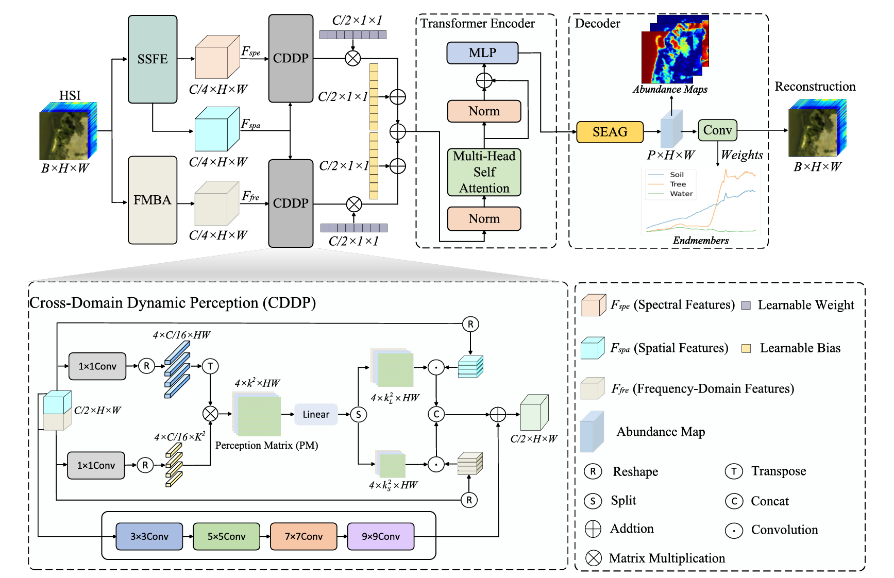

#MDFPF-Net: Multi-Domain Feature Perceptual Fusion Network for Hyperspectral Unmixing

<strong>:fire:New:bangbang:</strong></font></sup> Code is now available here.
___________

The repository contains the PyTorch implementations for MDFPF-Net: Multi-Domain Feature Perceptual Fusion Network for Hyperspectral Unmixing.


## Environment

This project is recommended to run with **Python 3.11.11**.

## data preparation

The dataset is available via [Baidu Netdisk](https://pan.baidu.com/s/1p-rvmH4Ohk_8tYc0uH8gJQ?pwd=675f, code: 675f).

## Installation

Please install the required dependencies before running the code:

```bash
pip install -r requirements.txt
```

## Introduction



If you use the code in your research, we would appreciate a citation to the original paper:

	@ARTICLE{11701611,
    author={Wu, Xiaocong and Sun, Le and Zhang, Guoqing and Chen, Yadang and Wu, Zebin},
    journal={IEEE Transactions on Geoscience and Remote Sensing}, 
    title={MDFPF-Net: Multidomain Feature Perceptual Fusion Network for Hyperspectral Unmixing}, 
    year={2026},
    volume={64},
    number={},
    pages={5529417-5529417},
    keywords={Modeling;Frequency;Educational institutions;Pixel;Transformers;Art;Frequency-domain analysis;Convolution;Modules (abstract algebra);Fuses;Deep learning (DL);dynamic perception;frequency-domain feature extraction;hyperspectral unmixing (HU);multidomain feature fusion},
    doi={10.1109/TGRS.2026.3735828}}
